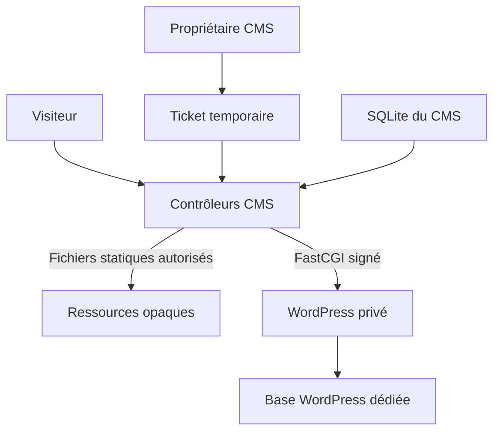

# WordPress Runtime 0.1 — expérimental et facultatif

Le paquet contient le connecteur, **sans WordPress installé ni activé**. Le CMS personnel reste PHP + SQLite et fonctionne seul. Le moteur facultatif utilise le vrai WordPress, ses thèmes et ses extensions, dans un processus distinct. Il garde ses propres données dans une base MySQL/MariaDB dédiée. Il n’utilise pas la base SQLite native et ne partage pas ses mots de passe.

La compatibilité dépend du module, des accès réseau, du CSP et des routes nécessaires. Les boutiques, comptes publics, paiements, multisite, tâches externes, import complet de données métier et modules demandant un point d’entrée PHP direct ne sont pas qualifiés. Aucun chiffre de latence ni gain de vitesse n’est garanti. La réécriture de chemins réduit leur exposition ; elle ne rend pas WordPress indétectable et ne corrige pas une extension vulnérable.

## Architecture



`wp.php` et `wp-assets.php` sont les seuls contrôleurs supplémentaires. Le CMS ne fait jamais de `require wp-load.php` : seul le worker le fait dans son processus. Le contexte signé expire, ne transmet pas les cookies natifs et ne donne aucun droit CMS au moteur. Le propriétaire obtient un ticket à usage unique valable 60 secondes ; la session du pont expire après 30 minutes et suit l’époque de révocation du compte CMS. WordPress conserve aussi ses propres cookies et ses contrôles de capacités/nonces.

## Installation serveur

1. Validez d’abord une sauvegarde du code et du stockage natif. Gardez WordPress et le stockage CMS dans **deux arbres distincts hors de la racine web**, par exemple `/srv/voilavoila-private/engine` et `/srv/voilavoila-private/native`.
2. Prévoyez deux origines HTTPS : `https://cms.example.com` et `https://legacy.example.com`. Le moteur ne partage jamais le hostname de l’administration native en production. Deux sous-domaines d’un domaine que vous contrôlez conviennent. Configurez le DNS et les certificats. Les fichiers publics CMS peuvent être servis sur les deux vhosts ; `VV_CANONICAL_ORIGIN` empêche d’y ouvrir l’administration native sur le hostname WordPress.
3. Créez un compte système `wp-engine` distinct de `cms`, ou un conteneur séparé. Installez PHP-FPM et les modules WordPress, dont `mysqli`, et une base **vide et dédiée** avec un compte SQL limité à cette seule base. WordPress recommande actuellement PHP 8.3+, MariaDB 10.11+ ou MySQL 8.0+, et HTTPS.
4. Préparez le ZIP officiel et sa vérification, hors du dossier du site :

```sh
python3 tools/fetch_wordpress_fixture.py --directory /srv/voilavoila-private/official-input
php -r 'echo bin2hex(random_bytes(32)), PHP_EOL;'
```

Le script utilise HTTPS, interroge la version actuelle officielle, vérifie chaque fichier par rapport au manifeste officiel et calcule le SHA-256 du ZIP complet. Le bundle privé expire après 24 heures. Si Python n’est pas disponible sur l’hébergement, exécutez-le sur votre poste puis transférez le ZIP et le bundle privé par SFTP. Le bundle doit rester un fichier de confiance de l’opérateur ; il n’est pas une signature de distribution indépendante.

5. Copiez et adaptez [wp-connector.php.example](examples/wp-connector.php.example) **hors webroot** en `wp-connector.php`. C’est du JSON précédé d’une garde PHP, pas un fichier à inclure avec `require`. Remplacez le secret par le résultat de la commande. Réglez `verification_bundle` sur le chemin exact produit ci-dessus. Injectez dans le pool natif et la CLI :

```sh
export VV_STORAGE_PATH=/srv/voilavoila-private/native
export VV_WP_CONNECTOR=/srv/voilavoila-private/wp-connector.php
export VV_CANONICAL_ORIGIN=https://cms.example.com
```

6. Activez **WordPress Runtime** dans les extensions CMS. Préparez le moteur depuis son panneau avec le ZIP officiel, les identifiants SQL et la confirmation `INSTALL`. Variante CLI : créez un JSON privé contenant `db_host`, `db_name`, `db_user`, `db_password`, puis :

```sh
php bin/console.php wp:quarantine:prepare /private/wordpress-VERSION.zip < /private/db-input.json
php bin/console.php wp:quarantine:status
```

Les chemins `/private/...` sont des exemples à remplacer. Ne passez pas le mot de passe SQL dans les arguments ou l’historique shell. Retirez le JSON d’entrée après préparation selon votre politique de conservation. La préparation refuse d’écraser un moteur existant. Le cœur et les secrets restent privés ; aucun téléchargement de WordPress n’est fait lors du fonctionnement natif.

7. Configurez le pool séparé à partir de [wp-fpm-pool.conf](examples/wp-fpm-pool.conf). Le code/configuration doit appartenir au déployeur/CMS, être lisible par `wp-engine` et **non modifiable par ce dernier**. Seuls `vv-data/` et `wp-content/uploads/` lui sont accessibles en écriture. Accordez au CMS la lecture des uploads pour le contrôleur statique (groupe/ACL adaptés). Redémarrez le pool après chaque changement de code ou configuration privée.
8. Installez les réécritures `/compat/` et `/assets/{ui,mod,core,admin,media}/`. Apache : règles fournies dans `.htaccess`, avec réécriture activée et configuration du pool natif. Nginx : adaptez [wp-nginx.conf](examples/wp-nginx.conf) et les interdictions du [vhost natif](nginx.conf). Le socket WordPress n’est jamais accessible depuis le proxy public. Vérifiez par HTTP que stockage, configuration, modèles du worker et fichiers PHP WordPress ne peuvent pas être téléchargés/exécutés directement.
9. Depuis **Moteur WordPress**, ouvrez l’accès propriétaire. Le premier ticket initialise la base vide. Le panneau WordPress sert à activer les thèmes/extensions. Le diagnostic `health` permet de constater PHP/PID/UID et quelques réglages ; il ne certifie pas l’isolation du système.

`open_basedir` et les fonctions désactivées sont des protections complémentaires, **pas une sandbox complète**. Il faut des permissions système distinctes ; une quarantaine stricte demande aussi des montages restreints et un filtrage réseau sortant au niveau système/conteneur. Les constantes WordPress bloquent son API HTTP, pas les sockets ou fonctions réseau qu’un plugin pourrait appeler directement. Ne prétendez pas à cette isolation sur un mutualisé où tous les processus ont le même UID. Si votre hébergement OVH/Infomaniak ne permet pas cette séparation, utilisez le CMS natif et l’import WXR ; le Runtime n’est pas un prérequis.

## Modules et actions publiques

```sh
php bin/console.php wp:theme:wrap /private/trusted-theme.zip
php bin/console.php wp:plugin:wrap /private/trusted-plugin.zip
```

Un ZIP doit contenir un seul dossier de module en minuscules. La commande calcule le manifeste SHA-256 dans `vv-manifests/`, sans exécuter le module. Les mises à jour se font par le déployeur, avec sauvegarde et nouveau manifeste ; pas d’éditeur ou de téléchargement de code dans WordPress. Les modules restent du code de confiance.

Toutes les actions AJAX et REST publiques sont fermées au départ. Une règle doit exister **à l’identique** dans `policy` du connecteur et dans `policy` du manifeste du plugin installé. Exemple d’une entrée sous `ajax` :

```json
{"my_contact":{"plugin":"my-plugin","methods":["POST"],"fields":{"email":"email","message":"text"}}}
```

Types : `text` (2 000 octets), `email`, `integer`, `boolean` (`0`/`1`). REST : clé de route exacte, telle que `/my-plugin/v1/contact`, sous `rest`. Pas de joker. Le plugin doit être actif et ses fichiers correspondre au manifeste. Les paramètres de query ET de corps sont contrôlés ; les conflits sont refusés. Les POST publics utilisent uniquement `application/x-www-form-urlencoded`, sans fichier, avec `vv_guest` ou `X-VV-Guest` fourni par le formulaire/script du pont. Le plugin doit conserver ses propres contrôles métier et anti-abus. Les requêtes propriétaires peuvent utiliser les capacités/nonces WordPress et les uploads limités à 8 Mio.

Les ressources statiques sont servies par liste d’extensions, vérification des chemins/liens et taille limitée, sans exécution PHP. Les URL opaques n’empêchent pas l’identification du logiciel. Le CSP de compatibilité autorise JavaScript inline et `eval` sur **l’origine WordPress uniquement** ; l’origine CMS garde son CSP strict. Les ressources externes sont bloquées par défaut. Il n’y a pas de cache HTML partagé du moteur dans cette version, afin de ne pas mettre en cache des nonces, formulaires ou sessions.

## Migration progressive et exploitation

Gardez d’abord WordPress sur son origine dédiée. Sauvegardez **séparément sa base SQL, tous ses fichiers, uploads, configuration et secrets** ; le ZIP de sauvegarde natif n’en contient aucun. Pour un site existant, testez une copie dans une base dédiée : restaurez le SQL et les uploads, conservez le bon préfixe dans `engine-config.php`, liez `owner_login` à votre administrateur WP existant, changez les salts et adaptez les URL sérialisées avec `wp search-replace --dry-run`. Arrêtez le pool avant ces modifications, puis redémarrez-le. N’initialisez pas une base contenant des tables étrangères. Une copie complète avec données de commerce demande sa propre procédure de qualification et de retour arrière.

WP-CLI, si installé par l’opérateur, doit être exécuté **comme utilisateur restreint du moteur**, avec `--path=/private/engine --require=/private/engine/vv-CLI.php`. Les helpers privés fournissent également :

```sh
php /private/engine/vv-Console.php version
php /private/engine/vv-Console.php upgrade
php /private/engine/vv-Console.php cron
```

La commande `upgrade` met à jour le schéma de base WordPress ; elle ne télécharge ni ne remplace son cœur. `cron` est à planifier explicitement par l’opérateur. Appliquez les correctifs WordPress par déploiement contrôlé, avec sauvegarde et pool arrêté. La mise à jour du cœur n’est pas automatisée dans 0.1.

Pour passer au natif : exportez WXR depuis WordPress (destination `export` du pont), regroupez les uploads dans un ZIP, puis utilisez Outils → Import WordPress du CMS. Réutilisez **la même URL source** à chaque import pour conserver l’idempotence. Vérifiez pages, articles, commentaires, documents, slug et redirections. Les données propres aux plugins ne deviennent pas automatiquement natives. Basculez l’accueil quand la validation est terminée, puis désactivez le Runtime. Une restauration native remet son activation/home à faux lorsque le plugin est actif. Une panne du connecteur à l’accueil conserve le rendu natif.

## Sources et limites des validations

- [Prérequis WordPress](https://wordpress.org/about/requirements/).
- [Sauvegardes WordPress](https://developer.wordpress.org/advanced-administration/security/backup/).
- [Limites de open_basedir](https://www.php.net/manual/en/ini.core.php#ini.open-basedir).
- [Recherche/remplacement WP-CLI](https://developer.wordpress.org/cli/commands/search-replace/).

Le rapport livré indique les versions et contrôles réellement exécutés. Un test local TCP/UID identique ne valide pas l’isolation par UID, Docker, TLS, ni un hébergement réel. Les débits et temps de réponse fournis dans la proposition initiale ne sont pas repris comme résultats mesurés.
